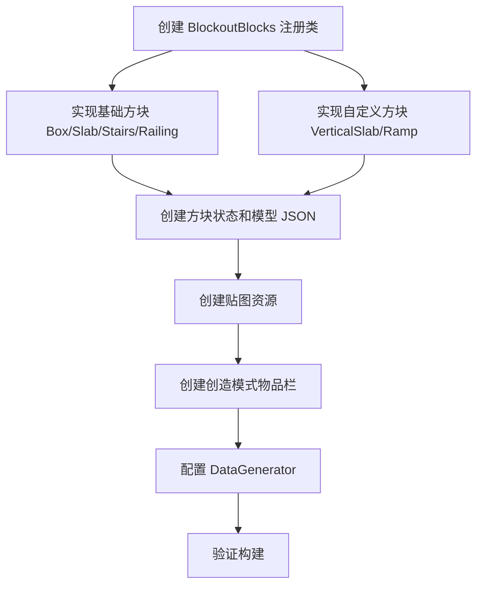

# BlockoutTools Fabric Mod 实施计划

## 项目概述

在 Minecraft Fabric 1.20.1 中实现类似 UE5 BlockoutToolsPlugin 的白模方块系统，用于关卡设计原型搭建。后续将支持导出到 UE4。

## 方块列表

| 方块 ID | 类型 | 实现方式 | 说明 |
|---------|------|---------|------|
| blockout_box | 完整方块 | 原版 Block | 1x1x1 立方体 |
| blockout_box_slab | 半砖 | 原版 SlabBlock | 水平半砖，上/下放置 |
| blockout_box_vertical_slab | 竖半砖 | 自定义 VerticalSlabBlock | 垂直半砖，带 FACING 属性 |
| blockout_railing | 栏杆 | 原版 FenceBlock | 类似原版栅栏连接逻辑 |
| blockout_ramp | 斜坡 | 自定义 RampBlock | 带斜坡碰撞箱，FACING 控制方向 |
| blockout_stairs_linear | 楼梯 | 原版 StairsBlock | 标准楼梯行为 |

## 文件结构

```
src/main/java/me/maceaura/blockouttools/
├── BlockoutTools.java              # 主入口，调用注册
├── block/
│   ├── BlockoutBlocks.java         # 方块注册中心
│   ├── VerticalSlabBlock.java      # 竖半砖自定义方块
│   └── RampBlock.java              # 斜坡自定义方块
├── client/
│   ├── BlockoutToolsClient.java    # 客户端入口
│   └── BlockoutToolsDataGenerator.java  # 数据生成器
└── datagen/
    ├── BlockoutModelProvider.java   # 模型数据生成
    ├── BlockoutBlockTagProvider.java # 方块标签
    ├── BlockoutLootTableProvider.java # 战利品表
    └── BlockoutLangProvider.java    # 语言文件

src/main/resources/
├── assets/blockouttools/
│   ├── blockstates/                # 方块状态 JSON
│   ├── models/
│   │   ├── block/                  # 方块模型 JSON
│   │   └── item/                   # 物品模型 JSON
│   ├── textures/
│   │   └── block/
│   │       └── blockout_grid.png   # UE5 风格网格贴图
│   └── lang/
│       └── en_us.json              # 英文语言文件
├── data/blockouttools/
│   └── loot_tables/blocks/         # 战利品表
├── fabric.mod.json
└── blockouttools.mixins.json
```

## 技术细节

### 1. VerticalSlabBlock 竖半砖

- 属性：FACING（NORTH/SOUTH/EAST/WEST）
- 碰撞箱：8像素厚的垂直面板
- 放置逻辑：根据玩家朝向决定面板方向

### 2. RampBlock 斜坡

- 属性：FACING（NORTH/SOUTH/EAST/WEST）
- 碰撞箱：使用阶梯式 VoxelShape 近似斜坡效果
- 模型：自定义三角形斜坡模型 JSON

### 3. 贴图风格

- 16x16 像素
- 白灰色底色 + 深灰色网格线
- 类似 UE5 BlockoutTools 的 1m 网格材质
- 由于无法直接生成 PNG，需要手动创建或使用占位贴图

### 4. 创造模式标签页

- 创建 BLOCKOUT_TOOLS 物品组
- 包含所有 blockout 方块

## 实施顺序



## 注意事项

1. 贴图 PNG 文件无法通过代码自动生成，需要手动创建一个 16x16 的网格贴图，或者先用纯色占位
2. Ramp 的斜坡碰撞箱使用多层 VoxelShape 组合来近似斜面效果
3. VerticalSlab 不是原版方块类型，需要完全自定义
4. 所有方块共用同一张贴图 blockout_grid.png
